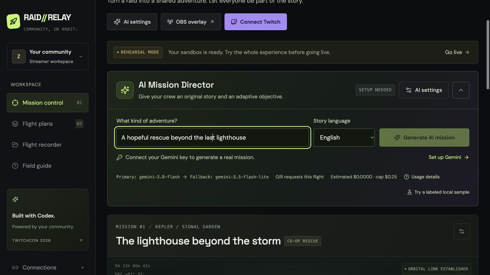
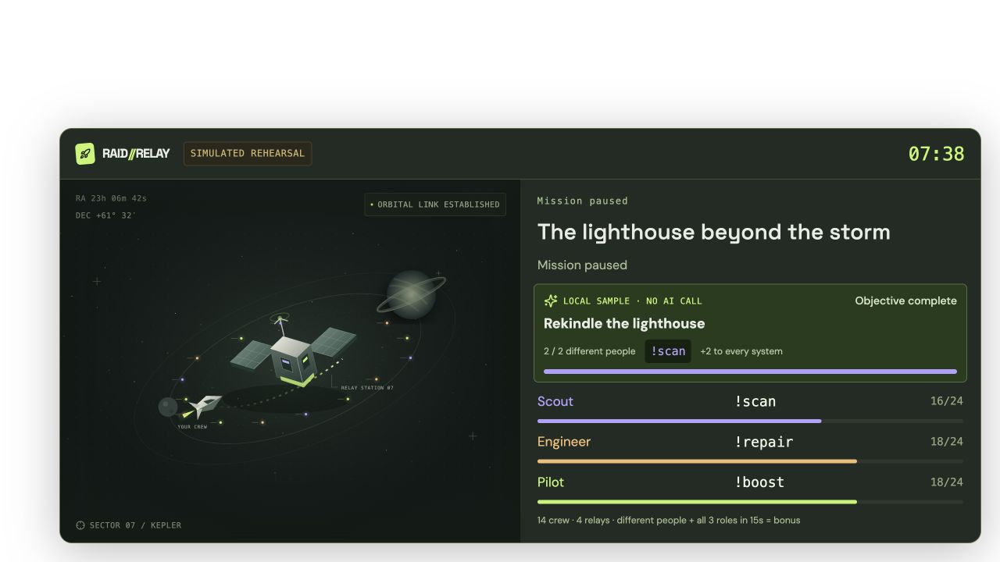

# RAID//RELAY

**An AI mission director. A Twitch chat rescue crew. One shared story.**

A cooperative Twitch experience where scouts, engineers and pilots power a shared rescue mission. Three different people acting in three complementary roles within 15 seconds trigger a relay bonus. Incoming raids open a 90-second boarding window with a contextual objective and a bounded first-action bonus, so new arrivals can immediately help.

Built with OpenAI Codex for the [Codex x TwitchCon Hackathon](https://twitchcon-codex.devpost.com/). The project is an independently built submission, not an official Twitch or OpenAI product.



## Run in two commands

Requires **Node.js 22+** and npm. Basic rehearsal works without credentials. Runtime AI uses your Gemini API key; Twitch mode uses your broadcaster authorization.

```sh
npm ci
npm run dev
```

Open **http://localhost:4317**. Click **Launch**, then **Play a simulated community** and **Simulate raid**. Pause, resume, end, and export the flight recorder. Simulated data is visibly labeled throughout the dashboard and overlay.

For a compiled local build:

```sh
npm run build
npm start
```

Keep the command running while using the dashboard and OBS. Run one instance per checkout. Both commands work on macOS, Linux and Windows.

## Let AI direct a real rescue

1. Open **AI settings**, paste a Gemini API key from [Google AI Studio](https://aistudio.google.com/api-keys), and save. The key stays in server memory; an ignored `.env` with `GEMINI_API_KEY` is an alternative.
2. Choose a theme and English or Vietnamese, then click **Generate AI mission**. **Gemini 3.8 Flash** is always tried first; **Gemini 3.5 Flash-Lite** is a single bounded fallback for eligible availability/response failures. The UI identifies the model that actually produced the draft.
3. Review the story, newcomer welcome, ending and playable side objective. Click **Publish mission & objective** to activate it. Before publication, drafts are invisible to the OBS state stream.
4. The objective requires 2–6 distinct people to contribute to the selected role in 30–120 seconds. Success adds a validated +1 to +3 to every system, once. One person's repeated actions cannot complete it. Its timer pauses with the mission.
5. Optionally enable automatic **drafting** when a raid arrives. Publishing still requires review. A labeled local sample is available in rehearsal for setup testing; it is not represented as a Gemini result.

AI calls run separately from game controls, so the streamer can still pause/end while a response is pending. Requests use aggregate progress and role counts, not raw chat, usernames or participant IDs. See [AI setup, fallback and cost](docs/ai-setup.md).

## Play together

| Role     | Chat command | What it powers |
| -------- | ------------ | -------------- |
| Scout    | `!scan`      | Signal array   |
| Engineer | `!repair`    | Hull integrity |
| Pilot    | `!boost`     | Jump drive     |

Fill all three systems before time runs out. One accepted action per person every six seconds by default, across all roles. A relay requires three distinct people, one in each role, within 15 seconds; it adds +2 to every system. Participants can switch roles. Subscribers, Bits and channel points provide no advantage.

Incoming raids open a 90-second boarding window. A person's first accepted contribution **in this mission** gives +2 instead of +1 if the welcome bonus is enabled. This does not identify whether they actually came with the raid, or whether they have visited the channel before. It welcomes any first mission contribution during that window. The goal stays fixed when a raid arrives.

## Connect real Twitch and OBS

Follow [the Twitch setup guide](docs/twitch-setup.md). Register an application with redirect URL `http://localhost:4317/auth/callback`, then enter its public Client ID in **Connections** and sign in as the broadcaster. No Client Secret is needed. The only requested permission is `user:read:chat`; the app reads chat and incoming raids and never sends chat messages.

End any rehearsal before connecting. A successful connection loads a fresh Twitch mission. Wait until both EventSub subscriptions are live, then launch. **OBS overlay** provides a local read-only browser-source URL; use 1920×1080. Recopy the URL after restarting the server. Your browser and OBS must be on the computer running the app.



## What is implemented

- Gemini-powered mission director with reviewed story/role objectives, a real distinct-person side objective, English/Vietnamese generation and explicit primary/fallback provenance.
- Streamer dashboard, three configurable flight plans using one rescue mechanic, live crew manifest and action feed.
- Deterministic mission engine, per-person cooldown, duplicate-event protection, timed three-person relays and bounded onboarding bonus.
- Read-only Twitch EventSub adapter with token validation, keepalive watchdog, backoff reconnect, session migration and subscription revocation handling.
- Transparent full and compact OBS browser-source overlays using the same authoritative server state.
- Explicitly labeled rehearsal and simulated-raid tools, blocked in Twitch mode.
- Local atomic mission snapshots; interrupted active missions restore paused. JSON flight-recorder export.
- Readable 16px body text, 44–48px controls, responsive layouts, confirmation/export before end/reset, keyboard controls, native dialog focus handling and reduced-motion support.

**Verification status:** automated engine/API/adapter/director tests and local browser rehearsal have been exercised. A [real Gemini 3.8 Flash generation](docs/live-ai-verification.md) succeeded without fallback, and its reviewed objective completed through three distinct simulated scout contributions. Live Twitch OAuth, real chat/raids, network migration, and OBS compositing still require validation with an authorized broadcaster and OBS. The project is not yet a completed hackathon submission. See [test evidence and remaining checks](docs/testing.md).

## Cost and data

Runtime AI uses **Gemini 3.8 Flash**, falling back once to **3.5 Flash-Lite** when eligible. Default local budget guard: **$0.25 per server process**, eight provider attempts per mission, 20 seconds between new requests, 2,048 output/thinking tokens per attempt. Each primary attempt reserves an estimated $0.03, fallback $0.01 at current configured prices; failures/timeouts keep their reservation because they may still be billed. Actual cost is estimated from reported token usage. This is not a provider billing cap. Free-tier availability and quotas depend on your Google project. [AI setup and pricing](docs/ai-setup.md).

Twitch traffic uses one EventSub socket, two subscriptions and startup/hourly validation. No AI call is made for every chat message. Development-time Codex usage is separate from runtime Gemini costs.

Gemini keys and Twitch OAuth tokens stay in process memory. AI prompts send the streamer’s theme and allowlisted aggregate mission state to Google. No raw audience chat or names are sent. Public Client ID is stored locally in the browser. Mission snapshots stay under ignored `private/runtime/`. No raw chat messages are persisted; accepted commands, display names, user IDs and mission events are used locally. The overlay receives display names but no tokens. [Architecture and privacy](docs/architecture.md).

## Develop and verify

```sh
npm test
npm run check
npm run build
npm audit --omit=dev
```

GitHub Actions runs tests, type checks/build and the production dependency audit. Lockfile is committed. Source is TypeScript, React, Vite, Express, Zod and `ws`; fonts are bundled locally and scene art is original SVG.

```text
src/         React dashboard, overlay and styling
shared/      Serializable mission contracts and flight plans
server/      Mission engine, local API, snapshots and Twitch adapter
tests/       Engine, Twitch payload and HTTP integration tests
docs/        Public research, setup, architecture and submission material
private/     Ignored strategy, runtime snapshots and personal preparation
```

See [submission draft](docs/submission.md), [demo script](docs/demo-script.md) and [research](docs/research.md). Commit messages follow Conventional Commits. MIT licensed; [third-party notices](docs/third-party-notices.md).
