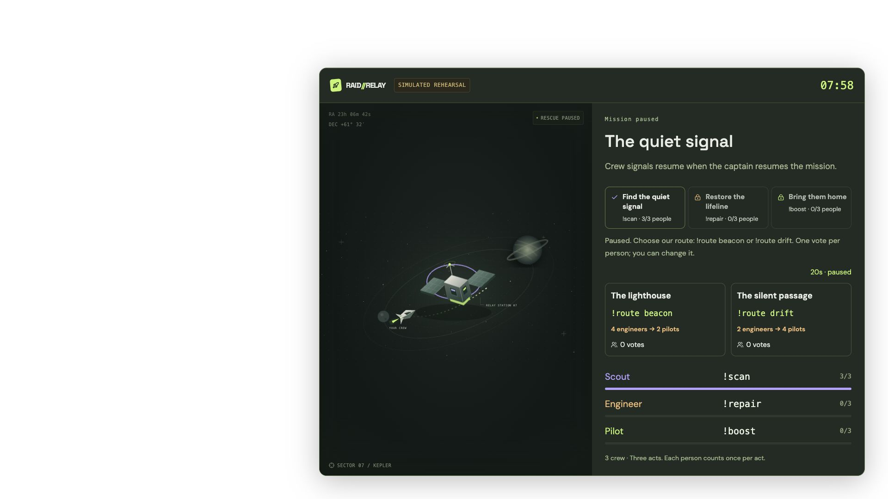

# RAID//RELAY

**An AI mission director. A Twitch chat rescue crew. One shared story.**

A cooperative Twitch rescue in three acts. Scouts find the stranded vessel, the community votes on a route, engineers restore the lifeline, and pilots bring it home. The winning route changes who the crew needs and how the story ends. Gemini writes the reviewed adventure; real chat makes it happen.

Built with OpenAI Codex for the [Codex x TwitchCon Hackathon](https://twitchcon-codex.devpost.com/). The project is an independently built submission, not an official Twitch or OpenAI product.


## Run in two commands

Requires **Node.js 22+** and npm. Basic rehearsal works without credentials. Runtime AI uses your Gemini API key; Twitch mode uses your broadcaster authorization.

```sh
npm ci
npm run dev
```

Open **http://localhost:4317**. Click **Launch**, then **Play a simulated community** and **Simulate raid**. Pause, resume, end, and export the flight recorder. Simulated data is visibly labeled throughout the dashboard and overlay.

For a compiled local build:

```sh
npm run build
npm start
```

Keep the command running while using the dashboard and OBS. Run one instance per checkout. Both commands work on macOS, Linux and Windows.

## Let AI direct a real rescue

1. Open **AI settings**, paste a Gemini API key from [Google AI Studio](https://aistudio.google.com/api-keys), and save. The key stays in server memory; an ignored `.env` with `GEMINI_API_KEY` is an alternative.
2. Choose a theme and English or Vietnamese, then click **Generate AI mission**. **Gemini 3.8 Flash** is always tried first; **Gemini 3.5 Flash-Lite** is a single bounded fallback for eligible availability/response failures. The UI identifies the model that actually produced the draft.
3. Before launch, review the premise, all three act objectives, the two route tradeoffs and their conditional endings. Click **Publish three-act mission**. Pending drafts stay private to the operator.
4. Launch the mission. The engine enforces distinct-person targets, the community's route vote and sequential role unlocks. The script stays locked throughout the flight; no generation is needed per chat command or vote.
5. A labeled local sample is available in rehearsal to learn the flow. It is not represented as a Gemini result. Classic mode remains available with the earlier timed side objective and optional raid-triggered draft.

AI calls run separately from game controls, so the streamer can still pause/end while a response is pending. Requests use aggregate progress and role counts, not raw chat, usernames or participant IDs. See [AI setup, fallback and cost](docs/ai-setup.md).

## Play together

| Role     | Chat command | What it powers |
| -------- | ------------ | -------------- |
| Scout    | `!scan`      | Signal array   |
| Engineer | `!repair`    | Hull integrity |
| Pilot    | `!boost`     | Jump drive     |

In the default **three-act expedition**, only scouts can advance the first act. Once three different scouts contribute, everyone can vote `!route beacon` or `!route drift` for 20 seconds. One vote per account; changing a vote replaces it. Beacon requires **4 engineers, then 2 pilots**. Drift requires **2 engineers, then 4 pilots**. A tie selects beacon. The captain can pause the vote or close it early. All three acts must finish before the rescue window closes.

The base crew target is configurable from 2–5. Each person counts once per act and may help again in a later act after the shared cooldown (six seconds by default). Locked roles cannot score. No subscriptions, Bits or channel points provide an advantage. Scans reveal the vessel, repairs restore its shield, and boosts move the rescue tug and cargo along the selected route.

Incoming raids open a 90-second boarding card with the current useful action; they never increase targets. Twitch does not identify individual raiders, so “welcomed” counts first contributions to this mission during the window. Expeditions count each person once, with no doubled contribution.

**Classic relay** remains selectable in Mission settings. It fills three fixed-goal systems together, with +2 to every system for three different people/roles within 15 seconds, optional first-action boarding points and a reviewed AI side objective. Existing snapshots retain classic mode. See [the expedition rules](docs/expedition.md).

## Connect real Twitch and OBS

Follow [the Twitch setup guide](docs/twitch-setup.md). Register an application with redirect URL `http://localhost:4317/auth/callback`, then enter its public Client ID in **Connections** and sign in as the broadcaster. No Client Secret is needed. The only requested permission is `user:read:chat`; the app reads chat and incoming raids and never sends chat messages.

End any rehearsal before connecting. A successful connection loads a fresh Twitch mission. Wait until both EventSub subscriptions are live, then launch. **OBS overlay** provides a local read-only browser-source URL; use 1920×1080. Recopy the URL after restarting the server. Your browser and OBS must be on the computer running the app.



## What is implemented

- Gemini-powered director with reviewed three-act scripts, two conditional endings, English/Vietnamese generation and explicit primary/fallback provenance.
- Streamer dashboard, three configurable flight plans using one rescue mechanic, live crew manifest and action feed.
- Deterministic sequential acts, editable one-account route votes, distinct-person targets, pause/recovery, cooldowns and duplicate-event protection. Classic relay mode is retained.
- Read-only Twitch EventSub adapter with token validation, keepalive watchdog, backoff reconnect, session migration and subscription revocation handling.
- Integration telemetry for accepted live commands/votes, raids, session recoveries and overlay connections, with JSON evidence export.
- Transparent full and compact OBS browser-source overlays using the same authoritative server state.
- Explicitly labeled rehearsal and simulated-raid tools, blocked in Twitch mode.
- Local atomic mission snapshots; interrupted active missions restore paused. JSON flight-recorder export.
- Readable 16px body text, 44–48px controls, responsive layouts, confirmation/export before end/reset, keyboard controls, native dialog focus handling and reduced-motion support.

**Verification status:** 57 automated tests, production build and browser rehearsal cover the upgraded expedition. Both rescue paths are tested; desktop, 390px mobile and 1920×1080 overlay layouts were inspected. Real Gemini 3.8 Flash has generated both the original classic objective and a complete three-act script without fallback. The broadcaster OAuth connection and both actual EventSub subscriptions are live. Real audience gameplay, incoming raids and OBS composition remain to verify; see [live evidence](docs/live-ai-verification.md) and [test status](docs/testing.md). A browser overlay preview is not an OBS recording, and this repository is not confirmation of a completed Devpost submission.

## Cost and data

Runtime AI uses **Gemini 3.8 Flash**, falling back once to **3.5 Flash-Lite** when eligible. Default local budget guard: **$0.25 per server process**, eight provider attempts per mission, 20 seconds between new requests, 3,072 output/thinking tokens per attempt. Each primary attempt reserves an estimated $0.03, fallback $0.02 at current configured prices; failures/timeouts keep their reservation because they may still be billed. Actual cost is estimated from reported token usage. This is not a provider billing cap. Free-tier availability and quotas depend on your Google project. [AI setup and pricing](docs/ai-setup.md).

Twitch traffic uses one EventSub socket, two subscriptions and startup/hourly validation. No AI call is made for every chat message. Development-time Codex usage is separate from runtime Gemini costs.

Gemini keys and Twitch OAuth tokens stay in process memory. AI prompts send the streamer’s theme and allowlisted aggregate mission state to Google. No raw audience chat or names are sent. Public Client ID is stored locally in the browser. Mission snapshots stay under ignored `private/runtime/`. No raw chat messages are persisted; accepted commands, display names, user IDs and mission events are used locally. The overlay receives display names but no tokens. [Architecture and privacy](docs/architecture.md).

## Develop and verify

```sh
npm test
npm run check
npm run build
npm audit --omit=dev
```

GitHub Actions runs tests, type checks/build and the production dependency audit. Lockfile is committed. Source is TypeScript, React, Vite, Express, Zod and `ws`; fonts are bundled locally and scene art is original SVG.

```text
src/         React dashboard, overlay and styling
shared/      Serializable mission contracts and flight plans
server/      Mission engine, local API, snapshots and Twitch adapter
tests/       Engine, Twitch payload and HTTP integration tests
docs/        Public research, setup, architecture and submission material
private/     Ignored strategy, runtime snapshots and personal preparation
```

See [submission draft](docs/submission.md), [demo script](docs/demo-script.md) and [research](docs/research.md). Commit messages follow Conventional Commits. MIT licensed; [third-party notices](docs/third-party-notices.md).
