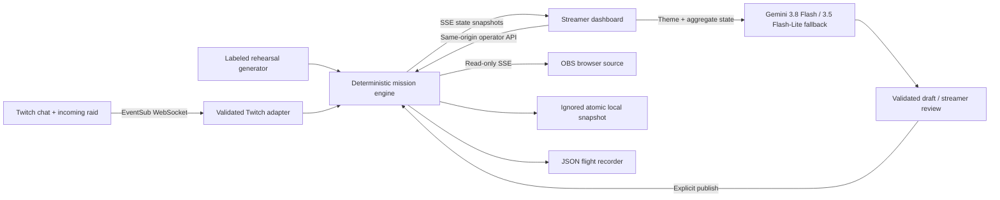

# Architecture, cost, and privacy

## One authoritative local mission

The Express server binds to `127.0.0.1`. Development serves Vite through middleware on the same HTTP port; production serves the compiled client. React displays serializable contracts from `shared/`. Browser state is a view, not a second source of truth. The engine accepts normalized commands and a clock dependency; tests use a controlled clock instead of waiting for timers.

## Game invariants

- Default expeditions advance through scout → 20-second route ballot → engineer → pilot → complete. A locked-role command cannot contribute or spend a cooldown. Completion is terminal until reset; timeout is checked on command arrival and by the ticker.
- Each account counts once per act and can return after the shared cooldown in a later act. Exact commands only, whitespace/case normalized. Payment status is never an input.
- One editable route vote per account, at most 10,000 voters. Ties/no votes choose beacon. Beacon needs base+1 engineers and max(2,base−1) pilots; drift reverses the tradeoff. Base is 2–5. The captain can close an active ballot early. Mission and ballot clocks pause together; mission timeout wins.
- Classic mode retains simultaneous fixed-goal systems, three distinct people/roles within 15 seconds for +2 per system, and optional first-action boarding points. These bonuses do not bypass expedition uniqueness or sequential acts.
- A raid creates a 90-second **wall-clock** boarding window, without changing targets or giving progress based on viewer count. Pausing the mission does not pause the arrival window or cooldowns. “Welcomed” means a first mission contribution during the window, not proven raid membership.
- Mission control accepts start/pause/resume/end/reset and closing an expedition ballot. Editing settings is blocked during active or paused missions; switching plans starts fresh state. Reconnect OAuth starts a fresh Twitch mission; export before changing missions.
- Mission snapshots are written through a temporary file and atomic rename every five seconds and at graceful shutdown. The latest five seconds may be lost after a hard crash. Restored active missions are paused. Expedition votes, unique contributor sets, selected route and remaining ballot time restore. Legacy snapshots load as classic. Dedupe and classic relay windows are deliberately not restored; old-session exact-once processing is not promised.

## Twitch transport

The broadcaster authorizes an installed, read-only client using the [implicit flow](https://dev.twitch.tv/docs/authentication/getting-tokens-oauth/#implicit-grant-flow), with a cryptographically random, ten-minute, one-time `state`. The callback clears the token fragment and posts it to the local server. Server-side [token validation](https://dev.twitch.tv/docs/authentication/validate-tokens/) verifies client ID, user ID, scope and validity at connection time and hourly thereafter. Tokens are held only in memory; this is a single-computer app, not a hosted multitenant OAuth service.

One [EventSub socket](https://dev.twitch.tv/docs/eventsub/handling-websocket-events/) creates `channel.chat.message` and incoming `channel.raid` subscriptions sequentially after welcome. Schema validation checks event shape, channel ID and subscription type. Chat IDs and raid envelope IDs are deduplicated in a bounded in-memory window. Messages originating in another Shared Chat channel are ignored.

Unexpected close triggers exponential backoff capped at 30 seconds with jitter and fresh subscriptions. Requested session migration opens the verified Twitch reconnect URL, waits for welcome, then retires the old socket without duplicating subscriptions. A watchdog detects missing keepalives. Revoked subscriptions and invalid tokens end the connection and expose an operator-visible error. Twitch does not replay events lost during disconnect; the UI states this. Real migration behavior still needs an account-based integration test.

## Local access model

- Host validation rejects unexpected hostnames to reduce DNS-rebinding exposure. No permissive CORS policy exists; foreign origins are rejected.
- The dashboard navigation bootstraps an unpredictable HttpOnly, SameSite=Strict operator cookie. Mutating API requests require this cookie and a matching local Origin. This is a local-computer trust model, not remote account authentication.
- Overlay URLs carry a separate random display key. It authorizes only the state stream; it cannot authenticate control requests. It rotates on restart. API responses do not contain Twitch credentials.
- Input payload limit is 8 KiB. Invalid bodies/settings are rejected. Viewer text is rendered by React, never injected as HTML. No arbitrary shell commands, raw chat execution or model tool calls exist. Gemini returns a validated JSON plan, not executable code or operator API calls.
- Mission UI collections are bounded: latest 40 activity items, latest 80 crew details, up to 10,000 distinct participants per mission, up to 10,000 recent dedupe IDs. State broadcasts are throttled to at most five frames/second with a one-second timer; slow consumers and more than 12 clients are refused/closed.
- This server is not hardened for exposing to the internet. Do not port-forward it. A malicious local process or another local user is outside its security boundary.

## What stays where

| Data                                      | Location and lifetime                                                                                                               |
| ----------------------------------------- | ----------------------------------------------------------------------------------------------------------------------------------- |
| Public Twitch Client ID                   | Browser localStorage, optionally local `.env`                                                                                       |
| OAuth token                               | Server memory, cleared on disconnect/restart; not persisted                                                                         |
| OAuth state/expiry                        | Browser sessionStorage until one callback or a new authorization                                                                    |
| Operator cookie / display key             | Current server lifetime; randomized at restart                                                                                      |
| Mission participant IDs and display names | Server mission state and ignored `private/runtime/mission.json`                                                                     |
| Raw chat messages                         | Examined transiently for exact commands; not stored                                                                                 |
| Accepted action feed                      | Last 40 events, including display names and command effects                                                                         |
| Flight recorder                           | User-downloaded JSON; contains names in the event feed, aggregate counts and simulation label; excludes full participant IDs/roster |
| Public research/docs                      | Git repository, no credentials                                                                                                      |
| Internal strategy                         | Ignored `private/strategy.md`                                                                                                       |

End/reset a mission to clear its current player map. The recorder stores only the current mission; there is no automatic archive or cloud analytics. Export before reset if you want history. Gemini AI requests require internet access. The two self-hosted font assets and original SVG art load locally, so rehearsal requires no third-party network calls after installation.

## Cost and quota

Runtime AI uses `gemini-3.8-flash` as primary with `thinkingLevel: low`. On an eligible transient/model-availability error or unusable structured response, it attempts `gemini-3.5-flash-lite` once with `thinkingLevel: minimal`. Credential/permission/configuration failures and safety refusals are not bypassed by fallback. Each attempt consumes the mission request limit and its own budget reservation. Model provenance is attached to the reviewed/published story.

The request is an allowlisted aggregate state and a streamer-entered theme. No raw chat, viewer IDs, names, OAuth tokens or roster are sent. In expedition mode the model proposes bounded act narratives and two conditional route endings; targets and transitions belong to the engine. The full script is approved before launch and cannot be replaced mid-flight. In classic mode it proposes a focus role, 2–6 distinct contributors, a 30–120 second window and a +1–3 reward to each system. A strict schema rejects out-of-range output; streamer approval is required. The engine counts accepted unique contributors and applies the reward once. Queued objectives activate at launch, active timers pause with the rescue, and expiry has no penalty.

Only approved content appears on the display state stream. Operator SSE includes pending drafts and cost metadata; overlay SSE excludes them. Local examples carry `source: sample` and are blocked from Twitch publication.

Default guard: $0.25/server process, eight provider attempts per mission, 20-second request cooldown, one concurrent generation, 3,072 output/thinking tokens/attempt, 16 KiB prompt-byte guard, cached identical ready-state requests. At current configured prices, the app reserves $0.03 before a primary attempt and $0.02 before fallback. Failed/aborted calls retain reservations. Byte limits/reservations are conservative engineering estimates, **not a guaranteed provider billing ceiling**. Actual estimates use reported prompt/total tokens and the attempted model's configured paid text rates. There is no automatic retry loop. See [AI setup](ai-setup.md) for sources, privacy terms and pricing.

At a normal successful connection: one token validation GET and two subscription POSTs, then one validation GET/hour. Reconnects add subscription calls; errors and retries affect actual counts. Incoming events do not trigger additional API calls. The connection panel counts attempted validation/subscription HTTP calls, received EventSub notifications, accepted live commands/votes, accepted raids and successful recoveries. Counters reset on a new Twitch connection. Export includes these aggregates. Overlay-client count includes ordinary browser previews, so OBS must be checked separately; it is not a Twitch quota meter, dollar invoice or stream viewer count. No chat messages are sent, so the app does not consume chat send-message buckets.

Use [Twitch rate-limit documentation](https://dev.twitch.tv/docs/api/guide/#twitch-rate-limits) and your actual provider responses as authority. No event rules found in [research](research.md) require a spending cap or runtime AI. Codex plan limits are separate; [official OpenAI pricing guidance](https://learn.chatgpt.com/docs/pricing) describes that distinction. Do not claim unlimited usage or invent a fixed Codex quota.

## Scope limits

This MVP is a local single-channel application with a three sequential acts, two community-selected routes, classic relay mode and three story presets. It is not a persistent cross-channel world, a moderation product, a Twitch Extension, or a proven large-scale service. The design hypothesis is that complementary contributions and arrival-context reduce the social cost of joining; actual retention or engagement improvement requires a real study.
