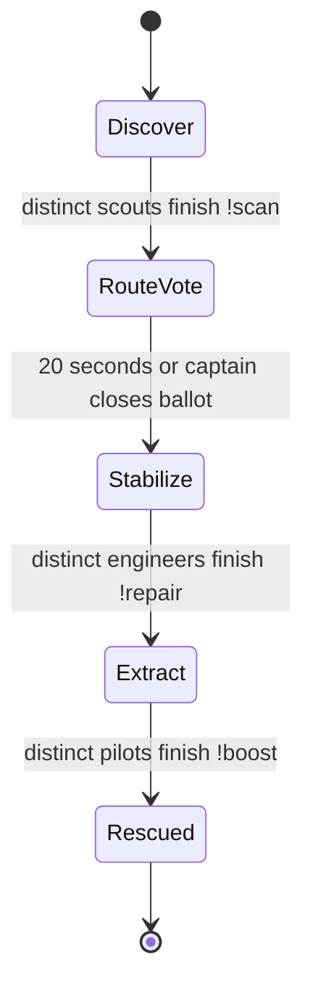
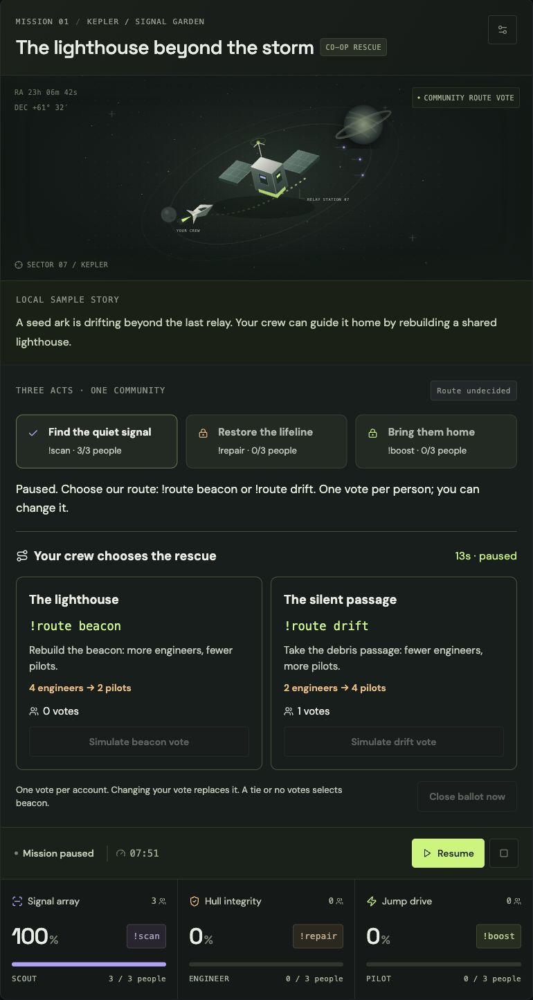

# A rescue written by the community

Three-act expeditions are the default for new installations. Existing mission snapshots keep classic mode until the streamer loads an expedition in Mission settings. Both modes remain available.

## The playable sequence

Only the current act accepts its role command. A person counts once per act and can return in a later act after the shared cooldown. Repeated commands cannot replace another person. Locked-role commands do not spend the player's cooldown. The default base target is three people; Mission settings permits two through five.

After scouting, each account may vote `!route beacon` or `!route drift`. A later vote from the same account replaces its previous choice. Voting does not require a prior contribution and does not spend a role cooldown. The 20-second ballot pauses with the mission. The captain may close an active ballot early; pause it to allow a discussion without consuming time. A tie or no votes chooses beacon. Main mission timeout takes precedence over voting and scoring.

| Route  | Engineers required | Pilots required  | With the default base of 3 |
| ------ | ------------------ | ---------------- | -------------------------- |
| Beacon | base + 1           | max(2, base − 1) | 4 engineers → 2 pilots     |
| Drift  | max(2, base − 1)   | base + 1         | 2 engineers → 4 pilots     |

The winning route changes required coordination, the displayed flight path and the eventual ending. A raid never changes these targets. Its 90-second boarding card shows the current useful action. Each new person still counts as one person; the classic first-action point bonus is not used in expeditions.

## Where AI contributes

Gemini 3.8 Flash writes an original premise, three act titles/objectives, two route descriptions and two conditional endings. The streamer reviews the entire script before publishing and launching. The same approved story remains in effect for the flight. The deterministic engine owns roles, targets, voting, transitions, timeouts and permissions; the model returns bounded narrative JSON rather than executable instructions.

A complete new expedition needs at most one successful generation. No model call occurs per chat command, vote or phase transition. Eligible failures have one explicitly labeled Flash-Lite fallback. Raid-triggered drafting remains available only in classic mode. Public overlay streams never receive unapproved drafts.

Rehearsal can use a clearly labeled local sample or the preset without a model call. These are not presented as AI generations. Classic mode retains the earlier reviewed, timed side objective and three-role relay bonus.

## Observable consequences

- Scans remove the fog over the stranded vessel. Every accepted contribution produces a role-colored signal pulse.
- Engineers rebuild an orbital shield. Completing stabilization attaches the rescued cargo to the tug.
- Pilots move the tug and cargo along the selected flight path; beacon and drift end at different positions.
- An incoming raid opens the boarding portal. Completing extraction reveals the approved ending for the winning route.
- The scene follows authoritative state. Reduced-motion preferences disable animated pulses and movement transitions while retaining the final state.

## Rehearse and verify

Launch a rehearsal. **Add crew** contributes to the current act; at the ballot, use the explicitly simulated vote buttons, then close the ballot or wait. **Play a simulated community** follows the same act/vote path automatically. Simulated inputs are rejected in Twitch mode.

Before a live run, connect Twitch, prepare and approve the story, then launch. With the default target, recruit at least four real accounts so either branch is reachable. The same accounts may help in later acts; allow the cooldown to pass. Do not describe simulated accounts as a real audience.

Live telemetry separates received EventSub notifications from accepted commands/votes, accepted raids, successful session recoveries and open overlay clients. These counts cover the current Twitch connection, including successive missions. A browser preview also counts as an overlay client; that counter does not prove OBS compositing. Recorder format `raid-relay/2` exports aggregate vote/contributor counts and integration evidence, without voter IDs, contributor IDs or credentials. Names may still appear in the accepted-action feed.

Interrupted active expeditions restore paused, including the ballot time, vote choices, selected path and per-act contribution sets. Legacy snapshots migrate to classic mode. See [verification limits](testing.md) for actual test evidence.
