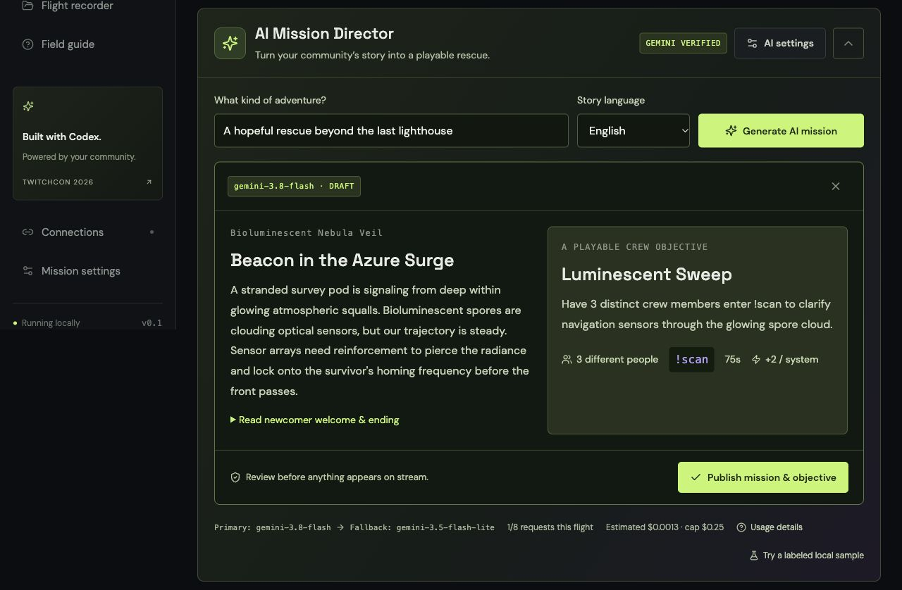
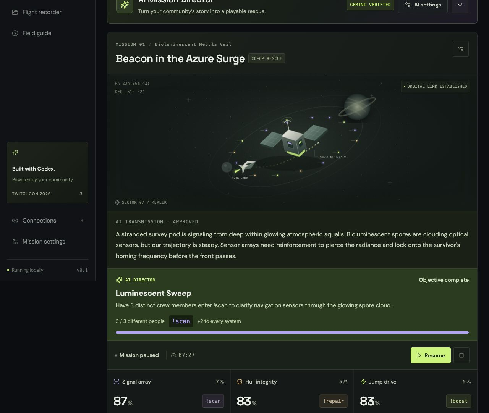
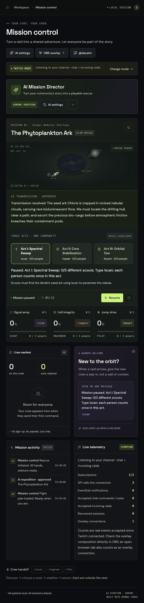

# Live Gemini verification — 30 October 2026

A real provider call was made through the running local application using an API key entered by the owner. No key, authorization header or provider credential is included here.

## Generation result

| Check                           | Observed result                         |
| ------------------------------- | --------------------------------------- |
| Local generation endpoint       | HTTP 200                                |
| Requested and successful model  | `gemini-3.8-flash`                      |
| Provider attempts               | 1                                       |
| Fallback                        | Not used                                |
| Reported input tokens           | 391                                     |
| Reported output/thinking tokens | 266                                     |
| Estimated paid text cost        | $0.00129075, using the configured rates |
| Generated story                 | Beacon in the Azure Surge               |
| Generated crew objective        | Luminescent Sweep                       |

The response passed the game's structured-output schema. The objective required **three distinct scouts** to send `!scan` within **75 seconds**, rewarding **+2 to every system**. The draft, newcomer welcome and ending were reviewed before publication.

## Gameplay verification

The approved draft was published into the existing **rehearsal** mission. Three distinct simulated scout actions completed its objective. No further Gemini call was needed for scoring. The mission was paused afterward.

| System         | Before actions | Ordinary action points | AI objective reward | After |
| -------------- | -------------- | ---------------------- | ------------------- | ----- |
| Signal array   | 16             | +3                     | +2                  | 21    |
| Hull integrity | 18             | 0                      | +2                  | 20    |
| Jump drive     | 18             | 0                      | +2                  | 20    |

The objective displayed **3/3 contributors** and **Objective complete**. This verifies a real Gemini output progressing through validation, review, publication and deterministic gameplay effects.

The model call was real; the crew/chat events in this check were simulated. This is **not** evidence of a live Twitch stream, real viewers, an incoming Twitch raid, or actual OBS compositing. Those account/device checks remain in [testing](testing.md).

Cost is an estimate from reported usage, not a provider invoice. The app's $0.03 reservation for the attempt is a local guard allocation, not a claim that the provider charged $0.03.

## Three-act expedition verification — 30 October 2026

The owner personally authorized the broadcaster account and re-entered the Gemini key. Twitch reached `live` with **2 real EventSub subscriptions**, **3 startup API calls**, and no synthetic notifications injected into the live mission.

A real primary call generated **The Phytoplankton Ark**, located in **Vesper Nebular Shallows**, with **Act I: Spectral Sweep**, **Act II: Core Stabilization**, and **Act III: Orbital Tow**. The route scripts were **Lighthouse Relay** (4 engineers → 2 pilots with the default base) and **Silent Trench Drift** (2 engineers → 4 pilots), with different conditional endings.

| Evidence                                | Observed value                                                |
| --------------------------------------- | ------------------------------------------------------------- |
| Actual model                            | `gemini-3.8-flash`                                            |
| Provider attempts / validated responses | 1 / 1                                                         |
| Fallback                                | None                                                          |
| Input tokens                            | 598                                                           |
| Output/thinking tokens                  | 531                                                           |
| Estimated cost at configured rates      | $0.00243975                                                   |
| Publication                             | Reviewed and published before launch into a Twitch expedition |

The script was launched on the real Twitch connection. At initial launch, accepted chat and raid counts were zero; this establishes provider generation and subscription setup, not a completed real audience rescue. Live chat results should be recorded separately as they occur. Automated tests and labeled rehearsal cover both branch outcomes. Actual OBS compositing, incoming raids and network recovery remain independent checks.

The owner deferred the live chat playtest. The mission was paused with no accepted commands or raids, preserving the approved script and remaining time. The final [allowlisted integration evidence](live-integration-evidence.json) records this limit explicitly.
